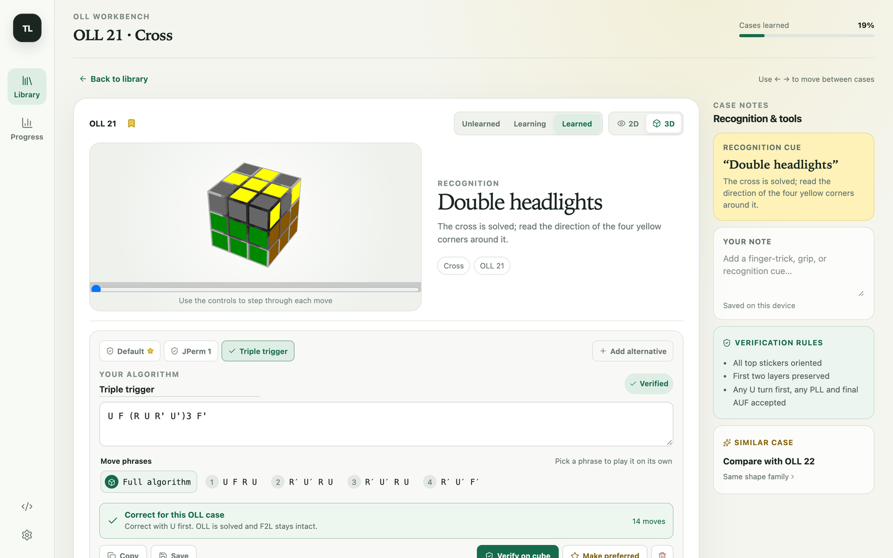
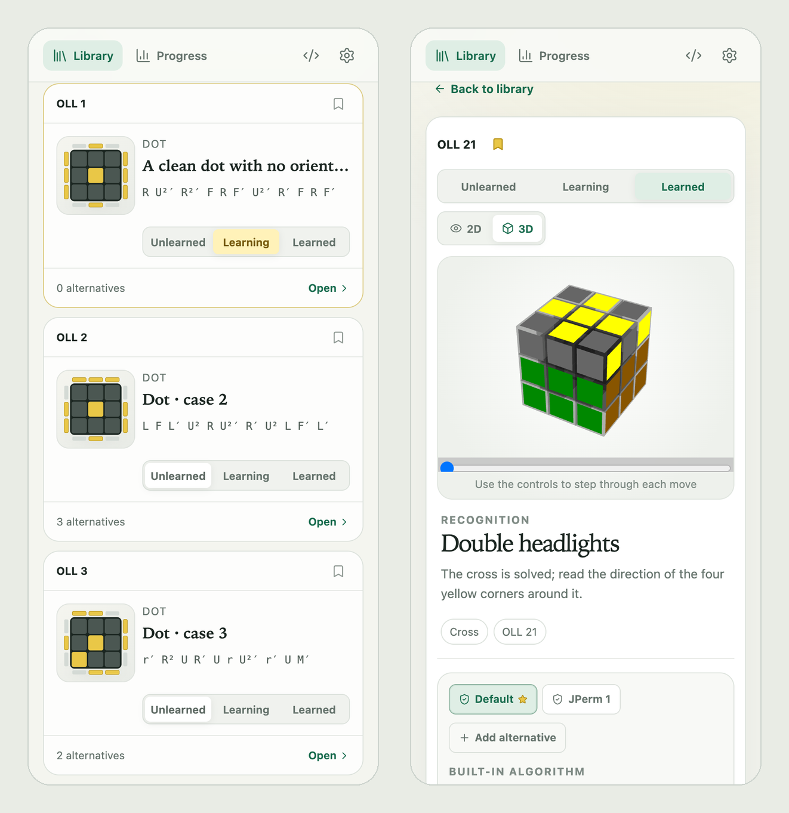
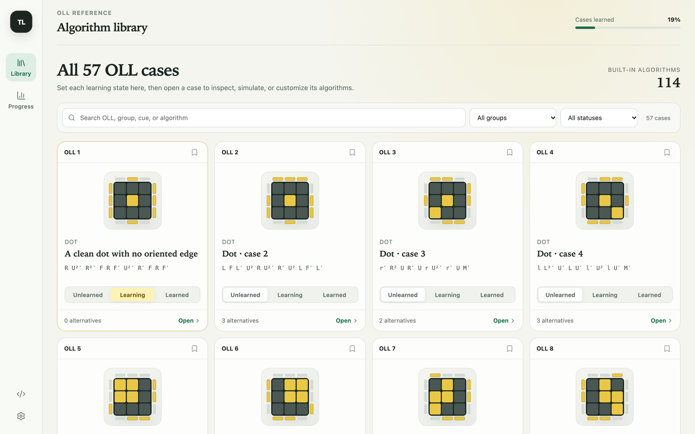
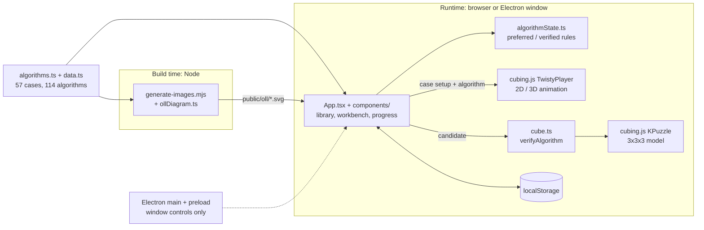

# Twisty Lab

[](https://github.com/AlphaShk/twisty-lab/actions/workflows/ci.yml)
[](LICENSE)

A study workbench for the 57 OLL cases of the Rubik's Cube, with a cube simulator that checks every algorithm you type before you rely on it.

**Live demo:** [alphashk.github.io/twisty-lab](https://alphashk.github.io/twisty-lab/). It runs in any modern browser, and the same build also runs in an Electron desktop shell.



## What and why

OLL (Orientation of the Last Layer) is the third step of the CFOP speedsolving method. With the first two layers (F2L) solved, one algorithm turns every top sticker to the top colour. There are 57 cases. Learning them means choosing an algorithm per case, recognising the case at a glance and drilling it. Cubers keep swapping in alternatives they find online, and a missing prime or cube rotation goes unnoticed until it wrecks a solve.

Twisty Lab keeps the whole set in one place. It has a filterable case library, an animated 2D/3D cube for every algorithm, and per-case notes and learning status. At its core is a verifier that runs any algorithm you enter on a cube model and tells you whether it really solves that case.

| | |
|---|---|
| Cases | All 57 OLL cases in 15 recognition-shape groups |
| Built-in algorithms | 114: a curated default for each case plus 57 JPerm listings that differ from it (duplicates of the default are hidden) |
| Verification | Your own algorithms must pass the simulator check before they can become the preferred one, and lose that status when their text changes |
| Tests | All 98 JPerm listings are cross-checked against the case that the curated default sets up; the 57 diagrams are regenerated and compared; a test enumerates all 216 last-layer orientation states to show the cases cover OLL |
| Case diagrams | Generated from the algorithms, not drawn by hand |
| Platforms | Web (GitHub Pages, responsive down to 375 px wide) and an Electron desktop shell |

## Features

- **Library:** search by case number, shape group, recognition cue or move. Filter by group and learning status, and bookmark cases.
- **Workbench:** a 3D or top-view 2D cube animated with [cubing.js](https://js.cubing.net/cubing/), held with yellow on top to match the case diagrams. Switch between the default algorithm, the JPerm alternatives and your own.
- **Move phrases:** each algorithm is split into phrases of four moves (cube rotations ride along and do not count). Pick one to replay it on its own from the position where it starts.
- **Your algorithms:** add, name, verify, save and delete alternatives. Only verified ones can be made preferred. Saving a changed text on the preferred one hands the preferred slot back to the default until the new text passes.
- **Study aids:** learning status (unlearned, learning, learned), notes, a progress dashboard with completion per shape group, side-by-side comparison with a similar case, and ← / → to step through cases.
- **Local first:** progress, notes and custom algorithms stay in the browser's localStorage. No account and no server.

<p align="center"></p>

## How verification works

`verifyAlgorithm` in [`src/cube.ts`](src/cube.ts) runs entirely on the cubing.js `KPuzzle` model of the 3x3x3:

1. **Rebuild the case.** It applies the inverse of the case's reference algorithm to a solved cube. The result is exactly the position that the reference algorithm solves.
2. **Apply the candidate.** It parses the notation (groupings, commutators and conjugates included), checks that every move exists on a 3x3x3, and applies it to that position, first as is and then after `U`, `U'` or `U2`.
3. **Normalise the orientation.** Candidates may contain rotations (`x`, `y`, `z`) or slice and wide moves that move the centres. The 24 whole-cube orientations are enumerated once by a breadth-first search over `x`, `y` and `z`, keyed by the centre permutation. The result is then turned so that every centre is back home.
4. **Accept OLL.** The four last-layer edges and corners must have orientation 0 (every U sticker on top). Every F2L edge and corner must be in its home slot with orientation 0. The last-layer permutation (PLL) and a final U turn (AUF) are left free.

If the algorithm only works after a U turn, the verifier says so and the app saves it with that turn in front: `F (R U R' U')3 F'` on OLL 21 gives *"Correct with U first"* and is stored as `U F (R U R' U')3 F'`. Failures are reported as a readable syntax error (for example an unclosed bracket, with the parser's own message underneath), a move the 3x3x3 does not have, *"OLL is oriented, but the algorithm changes an F2L piece"*, or *"F2L stays intact, but at least one top sticker remains unoriented"*. All of these are in the test suite.

### Case diagrams

[`scripts/generate-images.mjs`](scripts/generate-images.mjs) rebuilds each case the same way and reads the last-layer orientation directly from the `KPuzzle` pattern ([`src/ollDiagram.ts`](src/ollDiagram.ts)). A piece with orientation *o* shows its U sticker on facelet *o* of its slot, and facelets are numbered clockwise from the U face. From that, the script writes one SVG per case, the favicon and `build/icon.svg`. The 512 px `build/icon.png` that electron-builder needs is rasterised from that SVG separately and is not part of the `--check` run.

The tests check that the committed SVGs match the generator, that each diagram shows every U sticker exactly once, and that the shapes agree with the recognition groups (dot cases have no oriented edge, cross cases have all four, every other case has exactly two). They also show that the 57 cases are all of OLL: the test enumerates the 216 possible orientation states of the last layer, groups them into the 58 classes that remain under U turns, and checks that the 57 cases plus the solved state hit every class once.



## Architecture



The web build is static: relative asset URLs (`base: './'`) let the same `dist/` load from `file://` in Electron and from `/twisty-lab/` on GitHub Pages. The build also writes `third-party-licenses.txt` with the licence of every bundled package. In the browser the custom window bar is hidden. In Electron the window has no native title bar, `contextIsolation` and `sandbox` are enabled, and the preload script exposes only the platform name and the minimise, maximise and close actions.

## Quickstart

Requires Node.js 22.18 or newer.

```bash
npm ci                    # ELECTRON_SKIP_BINARY_DOWNLOAD=1 npm ci skips Electron for web-only use
npm run dev               # web app on http://127.0.0.1:5173
npm test                  # Vitest suite
npm run lint              # ESLint (typescript-eslint, react-hooks)
npm run format:check      # Prettier
npm run build             # type-check and build into dist/
npm run preview           # serve the production build
npm run dev:desktop       # Electron window with hot reload (needs the Electron binary)
npm run generate:images   # regenerate case diagrams, favicon and icon source
```

## Project structure

```text
src/
  App.tsx            app state, navigation and storage
  components/        library, workbench, progress view, cube player, dialogs
  hooks/             localStorage-backed state, debouncing, notation check
  algorithmState.ts  pure rules for default, JPerm and custom algorithms
  cube.ts            verifyAlgorithm and notation checks on the KPuzzle model
  notation.ts        parsing, move counting, phrase splitting, duplicate keys
  ollDiagram.ts      last-layer orientation reader and SVG renderer
  algorithms.ts      reference algorithms: curated defaults, JPerm lists, alignment rotations
  data.ts            cases, shape groups, recognition cues
  progress.ts        learning status and notes
  styles.css         design tokens, desktop shell and responsive layout
  *.test.ts          Vitest suites
scripts/
  generate-images.mjs
  third-party-licenses.mjs   Vite plugin that writes dist/third-party-licenses.txt
public/oll/          generated case diagrams (1.svg ... 57.svg)
electron/            main process and preload script
build/               app icon (SVG source and 512 px PNG) for electron-builder
docs/                README screenshots
.github/workflows/   CI and GitHub Pages deployment
```

## Tests and CI

| Suite | What it covers |
|---|---|
| `cube.test.ts` | Each curated default sets up a valid, unsolved last-layer case. All 98 JPerm listings, with their alignment rotation, solve the case the default sets up without any extra U turn. The UI shows 114 algorithms, no duplicates and no stacked rotations. Acceptance rules: final AUF, trailing rotations, rotations mid-algorithm, a needed U turn first. Rejections: F2L broken, wrong case, syntax errors with their messages, unknown moves, empty input |
| `algorithmState.test.ts` | Only verified algorithms become preferred, an edited preferred algorithm hands the slot back to the default, stored data is repaired, and a 1,000-step random sequence of edits never breaks that rule |
| `notation.test.ts` | Parsing, move counts without rotations, phrase splitting, rotation merging, duplicate detection |
| `ollDiagram.test.ts` | Group consistency, the 216-state enumeration, committed SVGs in sync with the generator |
| `styles.test.ts` | No font size below 12 px |

[`ci.yml`](.github/workflows/ci.yml) runs on pushes to `main` and on pull requests. It runs `npm ci` (without the Electron binary), ESLint, a Prettier check, `tsc --noEmit`, Vitest, a check that the generated images are current, and `vite build`. [`pages.yml`](.github/workflows/pages.yml) tests, builds and deploys `dist/` to GitHub Pages.

## Limitations

- It verifies algorithms but does not search for them. There is no solver and no pruning table.
- It covers OLL only, with no PLL or F2L training.
- Progress lives in one browser's localStorage, with no sync or export.
- Recognition cues are specific to 16 cases. The others use a generic hint for their shape group.
- Move counts skip whole-cube rotations and count slice and wide moves as one move each.
- The desktop shell has been run on macOS only. The packages are unsigned and not distributed; the electron-builder configuration is for local packaging.
- cubing.js loads its three.js-based 3D renderer as a single ~510 kB chunk the first time the 3D view is shown.

## Credits

- Algorithms (all alternatives and 41 of the 57 curated defaults, identical up to notation) and shape-group names: [JPerm's OLL list](https://jperm.net/algs/oll). The app labels them "Imported from JPerm" or "also listed as JPerm n". The other 16 defaults come from a personal list of preferred algorithms.
- [cubing.js](https://github.com/cubing/cubing.js): cube model, notation parser and player. Licensed MPL-2.0 OR GPL-3.0-or-later.
- [Lucide](https://lucide.dev) icons (ISC). [React](https://react.dev), [three.js](https://threejs.org), [Vite](https://vite.dev) and [Electron](https://www.electronjs.org) (MIT).
- The web build ships `third-party-licenses.txt` with the full licence texts of the bundled packages.

## License

[MIT](LICENSE) © 2026 Denys Shkola. Third-party libraries and data remain under their own licences.
